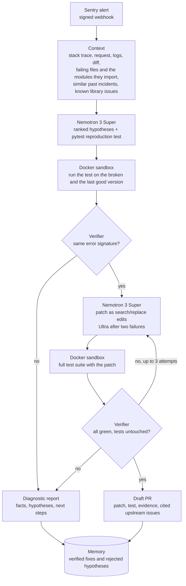

# Nightwatch

[](https://github.com/hackathon-hq-team/nightwatch/actions/workflows/tests.yml)

**An open-source AI on-call engineer that never proposes a fix it has not reproduced and verified.**

Nightwatch receives a production error from Sentry, investigates it with NVIDIA Nemotron on
Nebius Token Factory, reproduces the failure with a test in an isolated Docker sandbox, writes a
patch and verifies it. The on-call developer gets either a **Draft PR** with the fix, the
reproduction test and the evidence behind it, or an honest **diagnostic report** when the failure
cannot be reproduced.

Built for the Nebius × NVIDIA Global AI Hackathon 2026 · Track: Coding and Agentic Engineering ·
License: [MIT](LICENSE)

<!-- TODO: link to the demo video -->

## The problem

Small teams rarely have a dedicated SRE. When production breaks at night, a developer wakes up and
spends the first hour collecting logs, reading recent commits and guessing what changed. AI
assistants can suggest fixes, but a confident fix that was never tested is worse than none: it
costs review time and erodes trust.

## How it works



The model only proposes. Code runs the tests, a rule-based verifier decides, a human merges.

### Invariants

These hold in every run and are enforced by code, not by the model:

1. **No reproduction, no patch.** A test counts only if it fails with the alert's signature
   (exception type, message, file and function) on the broken version, and passes on the last good
   version when it is known.
2. **Acceptance criteria are fixed before the patch.** Test files are hashed; a patch that touches
   tests is rejected before it runs.
3. **A patch is accepted only if** the reproduction test and the whole existing suite pass.
4. **Untrusted code runs isolated:** a throwaway container with no network, no keys, a read-only
   root filesystem and resource limits.
5. **Limits:** at most 3 patch attempts, per-incident and daily budgets, a maximum diff size. Draft
   PR, never auto-merge, never deploy.
6. **Memory and web results are hints, not answers.** A remembered fix or a known upstream issue is
   reproduced and verified again.

## Results

Final runs on 28 October 2026 on the 17-scenario suite (HTTP endpoints, causes outside the
stack trace, a misleading deploy diff, a library regression, cases that must end in a report),
in the Docker sandbox with Tavily on. Two checks are reported separately: Nightwatch's own
verdict, and **independent acceptance** with hidden tests the model never sees.

| Measure | Result |
| --- | --- |
| Expected outcome reached | **17 / 17**, and 17 / 17 again on a second run |
| Verified fixes confirmed by hidden tests | **10 / 12** checked |
| Correct refusals (no invented fix) | **4 / 4** |
| Cost per incident | **$0.012** on average ($0.20 for all 17) |
| Time per incident | **52 s** on average |

Details, per-scenario numbers and every failure we found and fixed: [docs/results.md](docs/results.md).

## NVIDIA and Nebius stack

| Layer | What we use | Role |
| --- | --- | --- |
| Main model | **NVIDIA Nemotron 3 Super** via **Nebius Token Factory** | Investigation, reproduction test, patch, report |
| Escalation | **NVIDIA Nemotron 3 Ultra** | Takes over after repeated failures |
| Triage (optional) | **NVIDIA Nemotron 3 Nano** | Cheap first look before the investigation |
| Web search | **Tavily** | Known issues of the failing library, only when the error is raised inside one |
| Isolation | Docker | Reproduction and verification without network or secrets |
| Integrations | Sentry webhook, GitHub Draft PR, Streamlit console | Alert in, fix out, operator view |

Every model call records its model, tokens and cost, so each incident shows exactly what it cost.
The service runs locally in this submission; all model inference runs on Nebius Token Factory.

### How Tavily is used

Nightwatch searches the web only when the error is raised inside a third-party library or the
deploy changed a dependency version. The query is built by code from the package, its version, the
exception type and a scrubbed message: logs, request data and source code never leave the service.
Results are restricted to GitHub, Stack Overflow, PyPI and official docs. Each page becomes a
separate, citable piece of evidence marked external and unverified, and only pages the model
actually relied on appear in the Draft PR as "Known upstream reports".

## Quick start

Requires Python 3.11+, Git and, for the sandbox, Docker.

```bash
git clone https://github.com/hackathon-hq-team/nightwatch.git
cd nightwatch
python -m venv .venv && . .venv/bin/activate      # Windows: .venv\Scripts\Activate.ps1
pip install -e ".[ui,webhook,test-integrations]"
pytest -q                                         # offline tests: no network, no keys
```

Live runs on the scenario suites (needs `NEBIUS_API_KEY` in `.env`, see `.env.example`):

```bash
cp .env.example .env
docker build -t nightwatch-runner:dev -f docker/runner/Dockerfile .
python scripts/run_demo.py --check-only                              # key, models, runner
python scripts/run_demo.py --runner docker --web-search              # 7 scenarios
pip install -r diverse-app/requirements.txt
python scripts/run_demo.py --runner docker --web-search --suite diverse   # 17 scenarios
```

Operator console: `streamlit run app/streamlit_app.py` ([guide](docs/ui.md)).
Sentry → Draft PR end to end: [integrations](docs/integrations.md) and the
[local Sentry demo](docs/local-sentry-demo.md).

## Repository map

| Path | What it is |
| --- | --- |
| `nightwatch/` | The agent: pipeline, context, model client, prompts, edits, memory, web search, Docker runner |
| `verifier.py` | Reproduction and patch acceptance rules |
| `app/` | Streamlit console, Sentry receiver, Draft PR publishing |
| `demo-app/`, `diverse-app/` | Applications with realistic bugs for the scenarios |
| `evaluation/`, `tools/` | Scenario definitions, hidden acceptance tests, preparation and checking tools |
| `scripts/run_demo.py` | Live benchmark runner with cost and outcome summary |
| `docs/` | Design and operating guides |

Documentation: [agent design](docs/agent.md) · [verifier](docs/verifier.md) ·
[Docker runner](docs/docker-runner.md) · [scenarios](docs/scenarios.md) ·
[results](docs/results.md) · [all docs](docs/README.md)

## Limitations

- **Supported stack:** Python services tested with pytest (the scenarios include FastAPI endpoints).
- **Not auto-fixed by design:** failures that need production traffic or data — memory pressure
  under load, network timeouts, race conditions, configuration — end in a diagnostic report.
- **Context** goes one import level beyond the stack trace.
- **Green tests are not proof of a correct fix.** That is why hidden-test acceptance is reported
  separately, and why a human reviews and merges every Draft PR.
- **Not a deployment tool:** Nightwatch prepares and verifies a patch; merging and deploying stay
  with the team.

## Team

| Member | Role |
| --- | --- |
| Nikita ([@Senkin31](https://github.com/Senkin31)) | Agent: pipeline, context, model client, prompts, memory, web search |
| Danik ([@amudeeww-uefn](https://github.com/amudeeww-uefn)) | Verifier, bug scenarios, independent acceptance and metrics |
| Timur ([@Timurs-Vahitovs](https://github.com/Timurs-Vahitovs)) | Docker runner, Streamlit console, Sentry webhook, Draft PR, demo |
